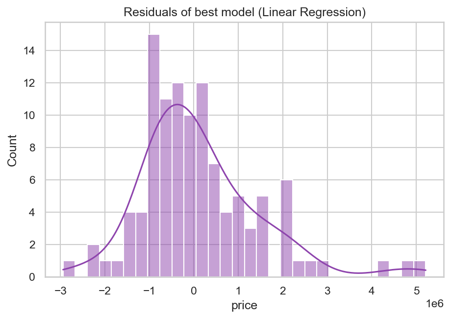

<p align="center"></p>
<p align="center"><a href="https://github.com/khnbutt118-dev">← PROFILE</a> &nbsp;·&nbsp; <a href="https://hassanbuttportfolio.vercel.app/">PORTFOLIO</a> &nbsp;·&nbsp; <a href="https://www.linkedin.com/in/hassan-butt-ab0036334/">LINKEDIN</a></p>

<p align="center"></p>

# 🏡 House Price Prediction · Regression Modelling
**A comparison of linear and tree-based models using property features.**

<table><tr><td align="center"><h2>545</h2><sub>Homes in dataset</sub></td><td align="center"><h2>0.645</h2><sub>Test R²</sub></td><td align="center"><h2>1.34M</h2><sub>Test RMSE</sub></td><td align="center"><h2>55%</h2><sub>Within 20% of price</sub></td></tr></table>

## 📊 Model evaluation gallery
<p align="center"></p>
<p align="center"></p>
<p align="center"></p>
<p align="center"></p>

## 🧠 Evaluation summary
| Measure | Result |
|:--|--:|
| Best model | **Linear Regression** |
| RMSE | **1,339,904** |
| R² | **0.645** |
| Predictions within 20% | **55.0%** |
| Selected features | **10** |

**Most influential features reported:** area, bathrooms and airconditioning.

## ⚙️ Modelling workflow
Preprocessing & encoding → Training-only feature selection → 80/20 split → 5-fold cross-validation → Model comparison → Residual analysis

## ▶️ Reproduce
```bash
pip install -r requirements.txt
python main.py
```

<details><summary><b>Dataset & outputs</b></summary>

- Dataset: [Housing Prices](https://www.kaggle.com/datasets/yasserh/housing-prices-dataset)
- Data used: 545 rows × 13 columns
- Compared: Linear Regression, Decision Tree, Random Forest
- Outputs: `model_comparison.csv`, `selected_features.csv`, `outputs/`

</details>
<p align="center"><sub>Python · Pandas · Scikit-learn · Regression analysis</sub></p>
