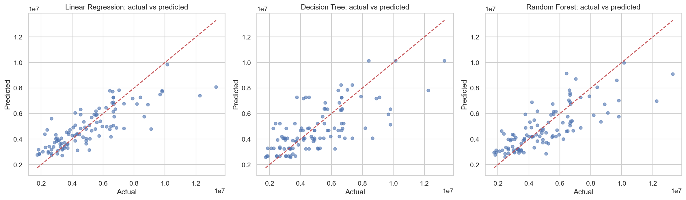
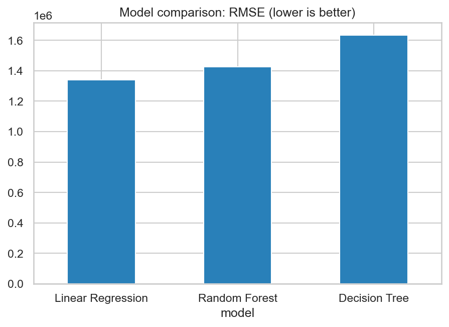
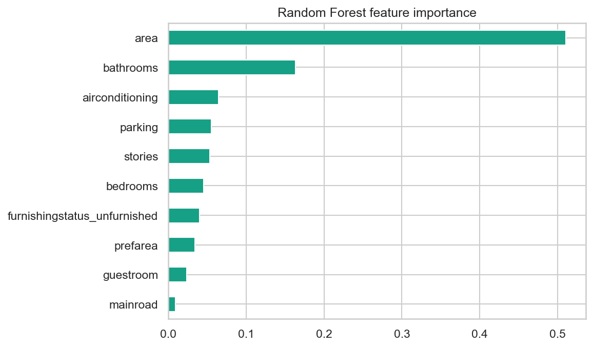

<p align="center"></p>

<p align="center"><a href="https://github.com/khnbutt118-dev">← Back to GitHub profile</a> · <a href="https://hassanbuttportfolio.vercel.app/">Portfolio</a> · <a href="https://www.linkedin.com/in/hassan-butt-ab0036334/">LinkedIn</a></p>

---

# Machine Learning Model (House Price Prediction)

> Synent Technologies Data Science Internship | Task 8 (Advanced level) | Author: Hassan Butt

## Problem statement
Build and evaluate models that predict house prices from property features.

## Dataset details
- **Dataset:** Housing Prices dataset
- **Source:** https://www.kaggle.com/datasets/yasserh/housing-prices-dataset
- **Size used:** 545 rows x 13 columns

## Approach
1. Preprocessing: yes/no encoding and one-hot encoding
2. Feature selection with SelectKBest (fit on training data only)
3. 80/20 train/test split with 5-fold cross-validation
4. Compared Linear Regression, Decision Tree and Random Forest using RMSE, MAE and R2
5. Feature importance and residual analysis

## Results
| Metric | Value |
|---|---|
| Best model | Linear Regression |
| RMSE | 1,339,904 |
| R2 | 0.645 |
| Within 20% accuracy | 55.0% |
| Features used | 10 |

**Key insights**

- Linear Regression performed best on the unseen test set (RMSE 1,339,904, R2 0.645).
- The most influential features were: area, bathrooms, airconditioning.
- About 55.0% of predictions fall within 20% of the real price (regression 'accuracy').
- Linear Regression gives an interpretable baseline, while tree-based models capture non-linear patterns.

**Figures**






**Other output files:** `model_comparison.csv`, `selected_features.csv`

## How to run
```bash
pip install -r requirements.txt
python main.py
```

## Project structure
```
main.py            # full analysis / pipeline
requirements.txt
data/              # dataset (see data/README.md)
outputs/           # figures, tables and reports
```

## Academic integrity
All analysis code and write-ups in this repository were written by the author. The dataset belongs to its original creators (see link above).
